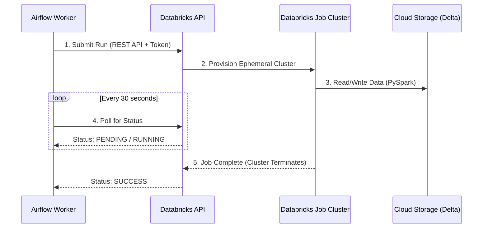

# PySpark & Databricks Learning Journey

This repository contains my learning progression and core conceptual examples for distributed data processing using Apache Spark (PySpark) and Databricks.

## Core Concepts Mastered

### 1. Cluster Architecture & Execution
* **Driver & Worker Nodes:** Understanding the delegation of tasks from the Driver (manager) to the Worker nodes (executors).
* **Lazy Evaluation:** How PySpark builds a Directed Acyclic Graph (DAG) of transformations but delays execution until an Action (`.show()`, `.count()`, `.write()`) is triggered.
* **Narrow vs. Wide Transformations:** Understanding the performance impact of network Shuffles caused by operations like `.groupBy()` and `.join()`.

### 2. DataFrame Operations (Transformations)
* **Explicit Schemas:** Defining exact data types using `StructType` and `StructField` to avoid expensive `inferSchema` operations.
* **Column Manipulation:** Using `col()`, `lit()`, and `.withColumn()` to filter data and engineer new features.
* **Handling Bitwise Operators:** Properly wrapping multiple conditions in parentheses `(col("Age") >= 18) & (col("isActive") == True)`.

### 3. Real-World Processing
* **Aggregations:** Grouping data and applying aggregate functions correctly using the `.agg()` wrapper to assign aliases (e.g., `.agg(sum("Amount").alias("Total_Spent"))`).
* **Joins:** Combining distributed tables using standard SQL-like join patterns (`inner`, `left`).

### 4. Databricks & Delta Lake
* **ACID Transactions & Storage:** Writing DataFrames to cloud storage using the `.format("delta")` specification with `mode("append")` or `mode("overwrite")`.
* **Time Travel:** Querying historical versions of a table for data recovery using `.option("versionAsOf", <version_number>)`.

### 5. Performance Tuning
* **Caching:** Using `.cache()` to store intermediate DataFrames in worker memory, preventing PySpark from re-evaluating the entire DAG for multiple actions.
* **Partition Management:** Using `.coalesce()` to reduce the number of partitions before writing small, highly-filtered DataFrames to storage, avoiding network shuffles and creating optimized file sizes.

---

## Code Reference: The Optimized Pipeline

Here is an example of a fully optimized PySpark script demonstrating reading, filtering, caching, and partitioning data:

```python
from pyspark.sql.functions import col

# 1. Read the data using the spark session from Delta storage
df = spark.read.format("delta").table("server_logs")

# 2. Filter for specific events (Narrow Transformation)
log_df = df.filter(col("log_level") == "ERROR")

# 3. Cache it in memory so the DAG isn't re-evaluated twice
log_df.cache()

# 4. Action 1: Count and print
error_count = log_df.count()
print(f"Total errors found: {error_count}")

# 5. Optimize partitions for the heavily filtered (smaller) dataset
compact_df = log_df.coalesce(2)

# 6. Action 2: Write the optimized data to a new Delta table
compact_df.write.format("delta").mode("overwrite").saveAsTable("error_log_summary")
```
## 🤝 Integration: Triggering Databricks from Airflow

In modern data architecture, Airflow acts as the "Brain" (orchestrator) and Databricks acts as the "Brawn" (compute engine). We never run heavy data processing on the Airflow server itself. Instead, Airflow uses the `DatabricksSubmitRunOperator` to trigger a PySpark notebook via the Databricks REST API.

### The Architecture Flow



### The Code Implementation

By passing a `new_cluster` configuration, Airflow tells Databricks to spin up a temporary cluster just for this job and immediately terminate it when the notebook finishes, saving massive compute costs.

```python
from datetime import datetime
from airflow import DAG
from airflow.providers.databricks.operators.databricks import DatabricksSubmitRunOperator

default_args = {
    'owner': 'platform_team',
    'retries': 1
}

with DAG(
    dag_id='databricks_daily_processing',
    default_args=default_args,
    start_date=datetime(2026, 10, 24),
    schedule_interval='@daily',
    catchup=False
) as dag:

    # 1. Define the compute specifications (Ephemeral Job Cluster)
    cluster_config = {
        'spark_version': '13.3.x-scala2.12',
        'node_type_id': 'i3.xlarge',
        'num_workers': 2
    }

    # 2. Define the notebook path in the Databricks Workspace
    notebook_task_config = {
        'notebook_path': '/Users/c.guha@mycompany.com/premium_customers_job',
    }

    # 3. The Operator that makes the REST API call
    run_databricks_notebook = DatabricksSubmitRunOperator(
        task_id='run_pyspark_job',
        databricks_conn_id='databricks_default', # Authenticates via PAT token stored in Airflow UI
        new_cluster=cluster_config,
        notebook_task=notebook_task_config,
        notebook_params={'execution_date': '{{ ds }}'} # Passing Jinja templates into PySpark!
    )
```